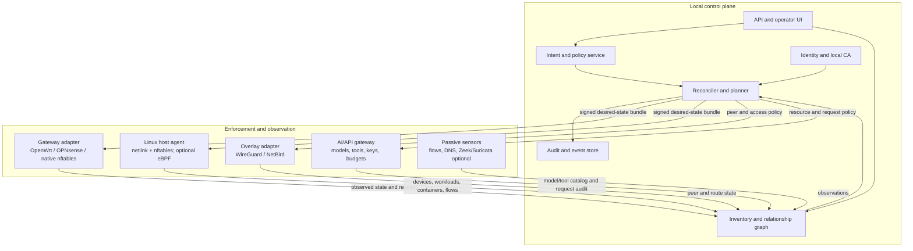

# AI fleet networking and firewall investigation

**Research date:** 10 November 2026  
**Scope:** A local-first networking and firewall control system for AI agents distributed across laptops, hosts, containers, and model servers on a home network.  
**Method:** Primary documentation and source repositories were used wherever available. Product claims are linked to their sources. Proposed design choices are explicitly labelled; they are not represented as facts about the current network.

## 1. Executive finding

The product should not begin as a fork of OpenWrt or OPNsense, and it should not try to put every capability into the router.

The strongest design is a separate, local-first control plane that:

1. maintains a live graph of devices, interfaces, networks, containers, agents, services, models, and tools;
2. accepts identity- and label-based connectivity intent;
3. compiles that intent to several enforcement planes;
4. verifies and rolls back every network change; and
5. continues forwarding the last known-good policy if the controller is unavailable.

The enforcement planes are necessarily different:

- The **gateway** controls VLAN/zone boundaries, routed traffic, NAT, DHCP/DNS, WAN egress, and unmanageable devices.
- A **host agent** controls same-host containers/processes and supplies stable host/workload identity.
- An optional **WireGuard overlay** handles roaming laptops and stable encrypted machine-to-machine reachability.
- An **AI/API gateway** controls semantic resources that an L3/L4 firewall cannot see: model/provider choice, MCP or tool endpoint, credential injection, quotas, and request audit.
- Optional **passive sensors** supply higher-fidelity flow and protocol evidence without becoming the source of policy truth.

This separation follows the actual limits visible in the researched systems. OpenWrt and OPNsense are strong gateway platforms; OpenWISP is a strong OpenWrt fleet controller; NetBird, Firezone, and OpenZiti are strong identity-aware overlays; Cilium and Calico are strong workload/host policy systems; SPIRE is a workload identity issuer; and LiteLLM/NetBird Agent Network operate at the AI request layer. None alone owns the entire resource chain.

## 2. What “networking position” must mean

“Position” cannot be represented by one IP address. IPs are leases, container addresses churn, laptops roam, and a model can move between servers. The product needs at least four simultaneous views:

| View | Question answered | Stable identity should be |
|---|---|---|
| Physical/L2 | Where is it attached? | device certificate plus interface identity; MAC is evidence, not identity |
| Routed/L3-L4 | Which zones and services can it reach? | policy subject/resource IDs mapped to current addresses |
| Overlay | Which authenticated peer is it? | public key/certificate-backed node identity |
| Application/AI | Which agent called which model or tool? | agent/workload identity carried to the gateway |

The canonical object therefore needs a durable ID independent of hostname, MAC, IP, container IP, or model URL. Those values belong in time-bounded observations.

## 3. Findings from OpenWrt

### 3.1 What OpenWrt is

OpenWrt is a Linux operating system and build framework for embedded devices with a writable filesystem and package management, not merely a firewall UI. Its own repository describes the build system as a way to produce target-specific firmware and packages for many architectures ([OpenWrt repository](https://github.com/openwrt/openwrt)).

Its small-system architecture replaces desktop components with `libubox`, `ubus`, `procd`, and `netifd` ([OpenWrt architecture](https://openwrt.org/docs/techref/architecture)). This is valuable for an appliance because the control surface is explicit and lightweight:

- **UCI** centralizes configuration for network, wireless, firewall, and services. Changes can be staged before commit ([UCI documentation](https://openwrt.org/docs/guide-user/base-system/uci)).
- **ubus** is the local IPC/RPC fabric used by networking, service management, wireless information, DHCP, logging, and UCI ([ubus guide](https://openwrt.org/docs/guide-developer/ubus)).
- **rpcd** exposes selected ubus functionality over JSON-RPC and applies role/ACL checks; its ACL model can distinguish UCI files as well as ubus methods ([ubus/rpcd technical reference](https://openwrt.org/docs/techref/ubus)).
- **procd** is PID 1, process supervisor, hotplug handler, watchdog, and—through `ujail`/`uxc`—an OCI-compatible lightweight container runtime ([procd README](https://git.openwrt.org/project/procd/tree/README.md)).
- **netifd** owns network interface state rather than leaving it spread across service scripts.

### 3.2 Firewall model

OpenWrt 22.03 and later use firewall4 to generate Linux nftables rules from UCI configuration. The UCI schema covers the common subset; explicit nftables includes remain possible for advanced cases ([firewall overview](https://openwrt.org/docs/guide-user/firewall/overview), [firewall configuration](https://openwrt.org/docs/guide-user/firewall/firewall_configuration)).

This gives a useful layering pattern for the proposed product:

`high-level intent → backend-neutral intermediate rules → OpenWrt UCI/fw4 → nftables`

The product should not generate an entire raw ruleset unless it owns the whole firewall. It should generate a named, isolated include or UCI-owned sections with durable rule IDs and comments, so locally created rules remain distinguishable.

### 3.3 Change safety and lifecycle

UCI supports staged changes. LuCI/rpcd also expose an apply-confirm mechanism that automatically reverts an unconfirmed change after a timeout ([UCI technical reference](https://openwrt.org/docs/techref/uci), [LuCI UCI API](https://git.openwrt.org/project/luci/tree/docs/api/modules/luci.model.uci.html)). This is a critical pattern to copy into the product's common transaction protocol.

OpenWrt upgrades replace the OS image and optionally restore preserved configuration. Attended Sysupgrade can rebuild a target-specific image with the requested package set and validates the downloaded image checksum before installation ([Attended Sysupgrade](https://openwrt.org/docs/guide-user/installation/attended.sysupgrade)). This is suitable for a later managed-appliance track, but it is operationally different from updating an ordinary Linux daemon.

### 3.4 What OpenWrt contributes

- Excellent base for a small physical gateway or access point.
- A compact RPC/configuration/service architecture worth adapting.
- Native Wi-Fi, switching, DHCP/DNS, routing, nftables, WireGuard packages, QoS, and device-target image tooling.
- A practical gateway adapter target through UCI/ubus.
- A possible future branded appliance image.

### 3.5 What OpenWrt does not solve alone

- Durable identity for an agent inside a container.
- Same-host container-to-container traffic if it never traverses the router.
- Model/provider/tool-level authorization inside encrypted HTTPS.
- Fleet-wide policy semantics across non-OpenWrt hosts.
- A complete multi-device control plane. OpenWISP exists precisely to add that layer.

## 4. Findings from OPNsense

### 4.1 Architecture

OPNsense is a FreeBSD/pf security appliance. Its documented architecture separates a PHP/Phalcon model-driven frontend from a Python `configd` backend over a Unix socket. XML-backed models validate and persist configuration; `configd` performs privileged system interactions and renders service configuration using templates ([OPNsense architecture](https://docs.opnsense.org/development/architecture.html)).

The repository is split across the base OS, ports, GUI/system configuration, and build tools. The `core` repository is BSD-2-Clause licensed ([OPNsense core repository](https://github.com/opnsense/core)).

This separation supplies three useful design lessons:

1. UI/API processes should not execute arbitrary privileged commands.
2. Privileged actions should be registered, narrowly parameterized, authorized, and audited.
3. Configuration models and generated runtime files should be separate artifacts.

`configd` actions name an executable, parameter form, output mode, allowed groups, log message, and optional cache behavior ([configd documentation](https://docs.opnsense.org/development/backend/configd.html)). A new product should use a typed internal RPC protocol instead of shell command templates, but preserve this capability boundary.

### 4.2 API and firewall automation

OPNsense exposes JSON APIs organized as `/api/<module>/<controller>/<command>`, authenticated with scoped API credentials and subject to effective user privileges ([API reference](https://docs.opnsense.org/development/api.html)). Its current API surface includes firewall, host discovery, interfaces, routing, traffic shaping, trust/certificates, DNS/DHCP, IDS, and WireGuard, plus plugins for LLDP, NetBird, Tailscale, ZeroTier, NetFlow-related tooling, and monitoring.

The firewall automation API has CRUD operations for aliases, filter rules, NAT, groups, rule statistics, and an explicit apply step. Changes are staged in configuration and become active when the firewall reloads ([firewall API](https://docs.opnsense.org/development/api/core/firewall.html)).

Important limitation: OPNsense documentation states that its automation rules are a separate managed view from the older core rules. An adapter must therefore own only its assigned namespace and must not assume the API represents every rule on the device.

### 4.3 Stateful firewall, discovery, monitoring, and HA

The underlying pf model is stateful: an allowed connection creates state so reply traffic need not match an independent return rule. OPNsense also integrates Suricata for IDS/IPS and a NetFlow exporter/analyzer ([OPNsense IPS](https://docs.opnsense.org/manual/ips.html), [NetFlow/Insight](https://docs.opnsense.org/manual/netflow.html)).

The API now includes host discovery, while the LLDP plugin exposes neighbor data ([host discovery API](https://docs.opnsense.org/development/api/core/hostdiscovery.html), [LLDP API](https://docs.opnsense.org/development/api/plugins/lldpd.html)). These are useful observation sources, not sufficient durable identities.

For high availability, OPNsense combines CARP failover, pfsync state replication, and configuration synchronization. Its documentation deliberately recommends controlled synchronization so a broken configuration does not immediately destroy the known-good backup ([high availability](https://docs.opnsense.org/manual/hacarp.html)). That operational pattern should be retained: config replication and policy activation are different actions.

### 4.4 What OPNsense contributes

- A strong x86 gateway/firewall appliance with mature UI and security functions.
- pf stateful filtering, NAT, VPN, shaping, IDS/IPS, NetFlow, HA, and broad API coverage.
- A permissively licensed core and a cleaner privileged-backend separation than many appliance projects.
- A viable adapter target when the user already operates OPNsense.

### 4.5 What OPNsense does not solve alone

- It is not a general Linux host/container enforcement agent.
- FreeBSD is not the natural base for Linux eBPF/CNI integration.
- Its appliance API is gateway-centric; it does not create model-level identity.
- Treating the firewall as the entire control plane would couple product availability to the network's most sensitive failure domain.

## 5. Similar and adjacent systems

| System | Proven capability worth reusing or emulating | Boundary for this product |
|---|---|---|
| **OpenWISP** | Central OpenWrt adoption, configuration templates, groups, variables, VPN/IPAM, monitoring, topology, and firmware upgrade. It uses NetJSON and device-side agents ([architecture](https://openwisp.io/docs/dev/general/architecture.html), [templates](https://openwisp.io/docs/dev/controller/user/templates.html)). | Best reference for gateway fleet management; not a cross-platform agent/model policy engine. |
| **pfSense** | Mature pf-based stateful firewall, NAT, VPN, traffic shaping, HA, diagnostics, and a generated runtime ruleset from one XML configuration source ([firewall fundamentals](https://docs.netgate.com/pfsense/en/latest/firewall/fundamentals.html), [configuration model](https://docs.netgate.com/pfsense/en/latest/config/xml-configuration-file.html)). | Relevant validation of the appliance pattern, but OPNsense exposes the cleaner open automation/API surface for this investigation. Product editions and licensing must be evaluated separately before reuse. |
| **VyOS** | Candidate configuration, diff, commit history, rollback, and timed `commit-confirm`; HTTPS automation and routing focus ([CLI](https://docs.vyos.io/en/rolling/cli.html)). | Strong automation/routing reference; not primarily a home fleet UI or workload identity system. |
| **IPFire** | Simple trust-zone presentation on top of a Linux firewall distribution; its current firewall documentation describes Linux netfilter/iptables ([firewall documentation](https://www.ipfire.org/docs/configuration/firewall)). | Useful UX precedent for understandable zones, but not the preferred technical base for a new nftables- and identity-oriented controller. |
| **FRRouting** | Full routing suite and model-driven northbound direction with transactions and YANG-oriented management ([FRR guide](https://docs.frrouting.org/en/latest/), [northbound architecture](https://github.com/FRRouting/frr/blob/master/doc/developer/northbound/architecture.rst)). | Add only if multi-router BGP/OSPF becomes real; unnecessary in the first home-LAN MVP. |
| **NetBird** | Self-hostable WireGuard mesh with management, signaling, relay, peer identity, DNS, routes, and distributed firewall policy ([architecture](https://docs.netbird.io/about-netbird/how-netbird-works)). | Excellent overlay candidate, but overlay policy cannot replace LAN segmentation or same-host workload control. Server-side folders use AGPLv3 from the documented license transition; client code remains BSD-3-Clause ([license notice](https://netbird.io/knowledge-hub/netbird-agpl-announcement)). |
| **Headscale/Tailscale clients** | Headscale is a self-hosted implementation of the Tailscale control server and explicitly targets a narrower single-tailnet scope for self-hosters and small organizations ([Headscale documentation](https://docs.headscale.org/)). | Viable lightweight overlay option, but it is intentionally narrower than the proposed inventory, gateway lifecycle, and AI resource planes. |
| **Firezone** | Default-deny identity/group-to-resource policy, gateways near resources, and direct/relayed WireGuard connections ([access model](https://www.firezone.dev/kb/common-workflows), [critical sequences](https://www.firezone.dev/kb/architecture/critical-sequences)). | Application/private-resource access layer, not general DHCP/VLAN/NAT management. |
| **OpenZiti** | Cryptographic identity, service names, dial/bind policies, dark services, tunneler or embedded SDK deployment ([identities](https://openziti.io/docs/learn/core-concepts/identities/overview/), [services](https://openziti.io/docs/learn/core-concepts/services/overview), [repository](https://github.com/openziti/ziti)). | Strongest application-overlay model, but heavier than necessary for a LAN-first MVP. |
| **Cilium/Hubble** | eBPF identity-aware L3-L7 policy, container networking, service maps, flow/drop visibility ([introduction](https://docs.cilium.io/en/stable/overview/intro/), [components](https://docs.cilium.io/en/stable/overview/component-overview/)). | Excellent for Kubernetes; too much operational surface for heterogeneous laptops as an MVP dependency. |
| **Calico** | Label-selected policy for workload and host endpoints, including forwarded traffic on routers; nftables/iptables or eBPF data planes ([host endpoints](https://docs.tigera.io/calico/latest/reference/host-endpoints/overview), [policy](https://docs.tigera.io/calico/latest/reference/resources/networkpolicy)). | Useful policy-language reference and possible Kubernetes adapter; not a complete device controller. |
| **SPIFFE/SPIRE** | Node and workload attestation followed by short-lived workload identity issuance through a local Workload API ([SPIRE concepts](https://spiffe.io/docs/latest/spire-about/spire-concepts/)). | Strong later identity substrate; first version can use a smaller device CA and mTLS while retaining compatible identity semantics. |
| **Zeek** | Passive, policy-neutral packet-to-event processing and rich connection/application logs ([architecture](https://docs.zeek.org/en/current/about/architecture.html), [logs](https://docs.zeek.org/en/current/tutorial/logs.html)). | Sensor/forensics plane only. It should not become the authoritative inventory or inline firewall. |
| **Suricata** | IDS/IPS and correlated EVE JSON flow/alert output ([EVE JSON](https://docs.suricata.io/en/latest/output/eve/eve-json-format.html)). | Optional security sensor; signature maintenance and encrypted traffic limits make it a later phase. |
| **LiteLLM** | One OpenAI-compatible gateway, provider credential custody, model allowlists, virtual keys, budgets, rate limits, and cost logs ([overview](https://docs.litellm.ai/), [virtual keys](https://docs.litellm.ai/docs/proxy/virtual_keys)). | AI application policy, not network segmentation. Budget enforcement depends on persistent spend state; its docs explicitly warn that some DB-less budget configurations fail open ([budgets](https://docs.litellm.ai/docs/proxy/users)). |
| **NetBird Agent Network** | Agent identity over the overlay, private AI proxy, provider-key injection, per-group model access, limits, and audit ([architecture](https://docs.netbird.io/agent-network/how-it-works), [policies](https://docs.netbird.io/agent-network/policies)). | Very close to the AI-specific slice, but documented as beta as of the research date; it still does not manage physical LAN segmentation and router lifecycle. |

## 6. Confirmed design constraints

These are consequences of the systems and traffic paths, not assumptions about the user's installation.

1. **A gateway cannot enforce traffic it does not see.** Same-host container traffic may remain in a bridge or namespace on one laptop. Host enforcement is required for that path.
2. **An encrypted overlay can reduce gateway visibility.** The gateway can see tunnel endpoints and volume but not inner service semantics unless it terminates the tunnel.
3. **A network firewall cannot reliably identify a model call inside TLS.** Model/provider/tool policy belongs at an authenticated application gateway or in the application itself.
4. **IP and MAC cannot be the primary identity.** IPs churn; containers are recreated; MAC randomization exists. Certificate/public-key-backed IDs must anchor observations.
5. **Agentless devices remain coarse-grained.** Printers, TVs, IoT devices, and unmanaged systems can be isolated by VLAN/SSID/zone and L3-L4 policy, but do not supply workload identity.
6. **Physical segmentation needs capable infrastructure.** VLAN policy cannot be realized across an unmanaged switch or AP that cannot tag/isolate traffic. Host or overlay enforcement is the fallback, not an equivalent replacement for every device.
7. **Control-plane failure must not stop the data plane.** Existing forwarding and policy must continue from last-known-good state.
8. **Visibility has privacy and performance costs.** Full packet capture and L7 inspection are not valid defaults. Flow metadata, counters, DNS observations, and explicit request audit should be the baseline.
9. **IPv6 must be first-class.** A design that only filters IPv4 creates a parallel, less-controlled path.
10. **Hardware/software flow offload can reduce observation accuracy.** The implementation must test whether flows bypass the chosen counter or sensor hook and report degraded visibility.

## 7. Proposed product boundary

### 7.1 In scope

- Discover and reconcile devices, interfaces, IP/MAC observations, networks, routes, workloads, containers, agents, services, model endpoints, and models.
- Assign stable identities and labels.
- Express default-deny or default-allow intent by environment/zone, with explicit policy precedence.
- Compile and deploy policies to supported gateways, hosts, overlays, and AI gateways.
- Manage DHCP reservations, internal DNS/service names, VLAN/zone membership where hardware permits, L3/L4 firewalling, controlled egress, and optional QoS.
- Show “why allowed/denied,” the enforcement points involved, and the current observed path.
- Audit every desired-state and runtime change.
- Safely stage, verify, confirm, or roll back network changes.
- Operate locally without a mandatory cloud service.

### 7.2 Deliberately out of scope for the first product

- Building a new packet-filtering kernel, VPN protocol, DHCP server, routing suite, or IDS engine.
- Replacing Docker, Podman, Kubernetes, or the AI workload scheduler.
- TLS interception as a default.
- General endpoint detection/response or antivirus.
- Managing arbitrary consumer switches/APs without documented APIs.
- Automated public exposure/port forwarding without an explicit approval gate.
- Letting an LLM directly apply privileged network changes. AI may explain, simulate, or draft intent; a deterministic compiler and transaction engine must perform enforcement.

## 8. Reference architecture



### 8.1 Control plane

**Inventory/relationship graph.** Store durable entities and time-bounded observations. A relational database is sufficient initially: PostgreSQL tables plus recursive queries are lower-risk than introducing a dedicated graph database. The API may expose a graph projection.

**Intent/policy service.** Stores versioned policy as immutable revisions. Human-readable labels select subjects and resources; the compiler resolves those selectors against a specific inventory snapshot.

**Reconciler/planner.** Compares desired and observed state, calculates an ordered plan, detects conflicts, produces backend-specific configuration, and waits for signed receipts.

**Identity service.** Issues a unique device certificate at enrollment. It must support revocation, rotation, short-lived workload credentials later, and an offline recovery key. SPIFFE-compatible URI naming is advisable even before deploying SPIRE.

**Audit/event store.** Append-only records for enrollment, policy revisions, plans, approvals, enforcement receipts, rollback, identity changes, and AI-gateway calls. Payload capture should be off by default; metadata and hashes are sufficient for most network audit.

### 8.2 Gateway adapters

Each adapter implements the same contract:

```text
capabilities() -> supported features and limits
observe()      -> normalized interfaces, networks, routes, leases, rules, counters
plan(intent)   -> backend-specific candidate plus semantic diff
validate()     -> syntax, capability, conflict, and management-path checks
stage()        -> inactive candidate
apply(ttl)     -> activate with confirmation deadline
probe()        -> verify data and management paths
confirm()      -> make candidate current
rollback()     -> restore previous known-good version
```

Initial adapters:

- **OpenWrt:** ubus/rpcd/UCI, firewall4-owned sections, dnsmasq/odhcpd observations, and apply-confirm.
- **OPNsense:** scoped API credentials, automation-rule namespace, aliases, firewall apply, interface/route/lease/host-discovery APIs, and configuration backup.
- **Native Linux gateway:** nftables JSON, netlink, systemd service isolation, dnsmasq or Kea, and a local watchdog. This is the eventual clean appliance path, not a prerequisite for the first release.

### 8.3 Host agent

The agent should be small, outbound-connecting, and incapable of accepting arbitrary shell commands. Proposed initial responsibilities:

- enroll with the local CA and rotate credentials;
- observe interfaces, addresses, routes, neighbors, listening sockets, and OS metadata through native APIs;
- subscribe to Docker/Podman events and inspect runtime networks through their local sockets;
- watch Kubernetes resources through the API when explicitly configured; Kubernetes supports list-plus-watch with resource versions for lossless state synchronization ([Kubernetes API concepts](https://kubernetes.io/docs/reference/using-api/api-concepts/));
- query configured model runtimes such as Ollama, whose API exposes local and running model lists ([Ollama API](https://github.com/ollama/ollama/blob/main/docs/api.md));
- enforce host/workload policy using isolated nftables tables/chains;
- report signed observed-state snapshots and apply receipts;
- retain the last-known-good bundle and enforce it while disconnected.

The Docker Engine API is versioned and can manage/observe containers and networks ([Docker Engine API](https://docs.docker.com/reference/api/engine/)). Access to the Docker socket is effectively highly privileged, so discovery should run in a narrowly isolated helper and never expose that socket to the control plane.

### 8.4 Overlay

Use an existing WireGuard control plane instead of inventing a VPN protocol. Overlay use cases:

- stable encrypted addressing across Wi-Fi changes;
- roaming laptops outside the home;
- controller-to-agent management reachability;
- optional service access that does not expose a LAN listener.

The overlay is not the canonical inventory and does not override physical segmentation. Peers, routes, and keys are synchronized into the inventory graph.

### 8.5 AI/API gateway

The gateway gives the firewall semantic visibility without TLS interception. It should:

- expose one private endpoint to fleet agents;
- authenticate the caller with mTLS/overlay identity, not a shared API key;
- map agent identity to allowed providers, models, MCP servers, A2A agents, or internal model services;
- inject upstream credentials at the last possible point;
- apply rate, token, concurrency, and cost limits;
- record request metadata, decision, model, latency, usage, and cost;
- keep prompt/response capture disabled unless a policy explicitly enables it;
- propagate a signed caller identity to trusted downstream gateways;
- fail closed for authorization and key injection, while keeping local self-hosted model paths independently available when policy permits.

## 9. Canonical resource model

### 9.1 Entities

| Entity | Examples | Durable key |
|---|---|---|
| Site | home, lab | generated UUID |
| Gateway | OpenWrt router, OPNsense VM | enrolled node ID |
| Device | laptop, server, printer | enrolled node ID; provisional discovery ID until claimed |
| Interface | Wi-Fi NIC, Ethernet, bridge, WireGuard | device ID + OS interface identity |
| Network | VLAN, subnet, SSID, overlay | generated network ID |
| Address observation | IPv4, IPv6, MAC, DNS name | entity + value + source + validity window |
| Workload | service/process group | orchestrator/runtime UID or signed agent identity |
| Container | Docker container, pod | runtime/cluster UID, never IP alone |
| Agent | coding agent, automation worker | workload identity plus owner/purpose metadata |
| Service | PostgreSQL, SSH, web API, MCP | generated service ID and endpoint set |
| Model endpoint | Ollama/vLLM/LiteLLM/provider API | generated endpoint ID |
| Model | model name plus immutable digest/version where available | endpoint + provider ID + digest/version |
| Capability/tool | filesystem MCP, Git service, calendar connector | generated resource ID |
| Identity | human, device, workload, agent | issuer + subject |
| Policy | connectivity or AI request intent | immutable revision ID |
| Flow/decision | observed connection or denied attempt | event ID + time |

### 9.2 Relationships

Core edges include:

`device attached_to network`  
`container runs_on device`  
`agent runs_as workload`  
`workload exposes service`  
`model served_by endpoint`  
`agent invokes model`  
`agent uses tool`  
`policy allows subject resource`  
`flow enforced_by gateway/host/overlay/aigateway`  
`observation reported_by sensor`

Every relationship needs provenance, first/last observed time, confidence, and desired-vs-observed status. A DHCP lease and an agent enrollment may both associate an address with a device, but the certificate-backed report has higher identity confidence.

## 10. Policy model

Policy should be intent-first and backend-neutral. A minimal representation:

```yaml
apiVersion: fleet.network/v1alpha1
kind: AccessPolicy
metadata:
  name: coding-agents-to-local-models
spec:
  subjects:
    matchLabels:
      fleet.role: ai-agent
      fleet.environment: home
  resources:
    matchLabels:
      fleet.type: model-endpoint
      fleet.exposure: internal
  network:
    direction: egress
    protocols:
      - name: tcp
        ports: [443, 11434]
  application:
    models: ["qwen/*", "llama/*"]
    tools: []
  conditions:
    devicePosture: managed
  action: allow
  logging: metadata
  priority: 500
```

The compiler produces separate artifacts:

- gateway L3/L4 rule if traffic crosses a routed boundary;
- host rule for local/bridge traffic;
- overlay peer/resource policy if the overlay path is allowed;
- AI gateway model allowlist and request limits.

Policy semantics must be documented before backend implementation:

- deny/allow precedence;
- stateful return behavior;
- selector resolution timing;
- default policy by layer;
- rule ordering and priority;
- behavior when a subject has no stable identity;
- IPv4/IPv6 equivalence;
- DNS/FQDN resolution and TTL behavior;
- stale inventory behavior;
- whether existing connections are terminated when policy changes;
- conflict behavior across gateway, host, overlay, and application layers.

The UI's most important answer is not “rule 37 matched”; it is:

> Agent A can reach Model M because policy P selected labels X/Y, compiled to gateway rule G and AI-gateway rule Q, both at revision R. The observed path is host H → VLAN V → gateway W → endpoint E.

## 11. Discovery and reconciliation

### 11.1 Passive-first discovery

Collect without probing first:

- DHCPv4/v6 leases;
- ARP and IPv6 neighbor tables;
- switch/AP association and VLAN data where APIs exist;
- LLDP neighbors;
- internal DNS registrations and queries at privacy-safe aggregation;
- mDNS advertisements, tagged as untrusted claims;
- gateway firewall/conntrack or pf states and counters;
- WireGuard/overlay peers and routes;
- host-agent interface, socket, runtime, workload, and model catalogs;
- AI gateway provider/model catalog and request decisions.

OpenWISP already demonstrates collection of DHCP leases, neighbor information, device health, interface traffic, and Wi-Fi clients in a central monitoring system ([OpenWISP architecture](https://openwisp.io/docs/dev/general/architecture.html)). NetJSON is specifically intended to interchange device configuration, monitoring, routes, and topology ([NetJSON overview](https://netjson.org/docs/what.html)). Those schemas are worth evaluating as import/export formats, but the product needs additional first-class agent/model/tool identity.

### 11.2 Active discovery

Active scans must be explicit, scoped, rate-limited, and attributable. They are enrichment only. A successful port probe does not establish ownership or identity.

### 11.3 Reconciliation states

Each entity should show:

- **observed/unclaimed** — discovered but not enrolled;
- **claimed/unmanaged** — associated with an owner but has no agent;
- **managed** — certificate-enrolled and reporting;
- **stale** — not observed within its source-specific TTL;
- **quarantined** — restricted by operator or automated posture policy;
- **revoked** — identity invalid; previous observations retained for audit.

## 12. Safe change protocol

Network automation needs a stronger transaction than ordinary CRUD:

1. **Snapshot:** read current backend state and record a hash/version.
2. **Resolve:** bind label selectors to a specific inventory revision.
3. **Compile:** generate backend artifacts with durable policy/rule IDs.
4. **Static validation:** reject unsupported features, shadowed/conflicting rules, invalid addresses, missing IPv6 equivalents, and rules that remove the management path.
5. **Simulation:** test representative flows against the compiled policy.
6. **Stage:** upload but do not activate.
7. **Apply with deadline:** use OpenWrt apply-confirm, VyOS-style commit-confirm, or an agent watchdog that reverts if the controller does not confirm.
8. **Probe:** test controller reachability, DNS, default route, required local services, and policy-specific canary paths from more than one vantage point.
9. **Confirm:** commit only if probes and backend health pass.
10. **Receipt:** store signed result, applied hash, timing, and warnings.
11. **Rollback:** automatically restore the previous version if confirmation expires or health degrades.

Additional guardrails:

- immutable emergency management rule;
- local console/break-glass recovery independent of the controller;
- one gateway canary before fleet rollout;
- maintenance windows for disruptive interface/VLAN changes;
- no concurrent uncoordinated writers to an owned rule namespace;
- drift detection without silently deleting unknown operator rules;
- policy bundles signed by the control plane and monotonically versioned to prevent replay.

## 13. Security model

The design follows the NIST position that network location alone grants no implicit trust and that subjects and devices should be authenticated before access to resources ([NIST SP 800-207](https://csrc.nist.gov/pubs/sp/800/207/final)). It also retains ordinary segmentation: identity-aware access is additive, not a reason to keep a flat LAN.

Threats that the design must test:

| Threat | Required control |
|---|---|
| Compromised AI agent attempts lateral movement | per-agent identity, default-deny service policy, host plus gateway enforcement |
| Prompt/tool injection causes network reconfiguration | AI has draft/explain rights only; deterministic planner; human approval for privileged changes |
| Stolen device credential | short lifetime, rotation, revocation, device posture, audit |
| Shared provider key leaks from laptop | upstream keys held at AI gateway; callers use identity, not provider key |
| Controller compromised | signed/audited changes, least-privileged adapters, two-person approval option, gateway-side constraints |
| Malicious or spoofed discovery data | provenance/confidence, certificate-backed identity, no auto-trust from DHCP/mDNS/MAC |
| Bad rule locks out the network | staged apply, management-path lint, timed rollback, local recovery |
| Control plane goes offline | last-known-good policy remains; no dependency in packet forwarding path |
| Gateway is bypassed by same-host traffic | host enforcement and runtime observation |
| IPv6 bypass | policy compiler must emit and test both families |
| Telemetry leaks prompts or sensitive traffic | metadata default; payload capture opt-in with retention/access controls |

## 14. Implementation strategy

### 14.1 Build versus reuse

**Build:**

- canonical resource/relationship model;
- controller API and operator UI;
- desired/observed reconciler;
- backend-neutral policy language, compiler, simulator, and explain engine;
- signed transaction/receipt protocol;
- minimal cross-platform agent and runtime/model discovery plugins;
- gateway/overlay/AI-gateway adapters;
- product-specific topology and decision graph.

**Reuse:**

- nftables/pf for packet enforcement;
- WireGuard and an existing control plane for overlay;
- OpenWrt or OPNsense as initial gateways;
- dnsmasq, odhcpd, Kea, or Unbound rather than a new DHCP/DNS implementation;
- Docker/Kubernetes/Ollama APIs for inventory;
- LiteLLM or another proven gateway behind a product adapter if its current license/security posture passes review;
- PostgreSQL for durable state;
- OpenTelemetry/Prometheus-compatible metrics and structured logs;
- Zeek/Suricata only as optional sensors.

### 14.2 Why not fork first

A fork immediately inherits firmware builds, hardware support, kernel/package CVEs, upgrade testing, UI migration, and upstream merge work. It does not solve host, overlay, or AI-layer policy. An adapter-first controller proves the unique value while preserving the option to ship an OpenWrt-derived image later.

### 14.3 Suggested component shape

- **Controller:** Go or Rust services with PostgreSQL; one deployable process initially, modular internal packages rather than early microservices.
- **Host agent:** Rust or Go static binary; mTLS; local plugin/helper boundary for privileged runtime APIs.
- **Policy compiler:** deterministic pure library with golden tests; no LLM in the enforcement path.
- **Gateway helper:** smallest possible daemon where native APIs are insufficient; outbound connection only.
- **UI:** topology, inventory, policy, changes, and decisions. The policy diff/rollback experience is more important than dashboard density.

Language selection remains an engineering decision, not a researched fact. Choose after prototyping cross-compilation, privilege separation, memory footprint, and the teams' operating experience.

### 14.4 Licensing implications

- OpenWrt's main repository is GPL-2.0-only, with additional component licenses ([COPYING](https://github.com/openwrt/openwrt/blob/main/COPYING)).
- OPNsense core is BSD-2-Clause ([repository](https://github.com/opnsense/core)).
- NetBird documents BSD-3-Clause client code and AGPLv3 server-side management/signal/relay folders from v0.53.0 ([announcement](https://netbird.io/knowledge-hub/netbird-agpl-announcement)).
- Cilium user space is Apache-2.0; its BPF templates have additional GPL-2.0-only/BSD-2-Clause licensing choices ([Cilium README](https://github.com/cilium/cilium/blob/main/README.rst)).
- Calico is primarily Apache-2.0 with specific eBPF code licensing documented separately ([Calico license](https://github.com/projectcalico/calico/blob/master/LICENSE.md)).
- OpenZiti is Apache-2.0 ([repository](https://github.com/openziti/ziti)).

An adapter calling a public API is different from copying/linking code or distributing a derivative firmware image. A dependency/license bill of materials must be generated against exact pinned commits, and product counsel should review distribution and hosted-service obligations before selecting reusable server components.

## 15. Phased delivery

### Phase 0 — Evidence-gathering lab

Deliverables:

- inventory collector for one OpenWrt and/or OPNsense gateway;
- Linux agent observing interfaces, Docker containers, listening services, and Ollama models;
- normalized topology/resource graph;
- no enforcement;
- packet-path and capability report for the actual hardware.

Exit criteria:

- devices and workloads retain identity through DHCP changes and container recreation;
- IPv4 and IPv6 are both visible;
- the graph marks provenance/confidence and does not merge ambiguous devices automatically.

### Phase 1 — Safe gateway policy

Deliverables:

- versioned policy CRUD and selector resolution;
- OpenWrt adapter first, OPNsense adapter second, or reverse the order based on the real gateway;
- dry-run, semantic diff, rule ownership, staged apply, health probes, confirm/rollback, and audit;
- zone/VLAN and egress policies for agentless devices.

Exit criteria:

- a deliberately bad rule automatically rolls back;
- pre-existing unrelated firewall rules survive;
- policy explanation traces intent to backend rule and observed result;
- controller outage does not interrupt existing flows.

### Phase 2 — Host and overlay identity

Deliverables:

- certificate enrollment/rotation/revocation;
- nftables host enforcement for containers and services;
- WireGuard/NetBird adapter;
- stable service discovery names independent of DHCP address;
- quarantine workflow.

Exit criteria:

- same-host denied flows are blocked;
- a roaming laptop retains identity and allowed services;
- revoked peers lose new access while unaffected services continue.

### Phase 3 — AI resource plane

Deliverables:

- model/provider/tool resource catalog;
- private AI gateway adapter;
- per-agent model/tool allowlists, credential injection, concurrency/rate/budget controls;
- metadata audit and cost/usage attribution;
- explicit payload-capture policy.

Exit criteria:

- two agents on one laptop receive different model/tool rights;
- no upstream provider key exists on the agent laptop;
- denied model/tool requests are explainable by policy revision;
- limits fail closed when their persistent state is unavailable.

### Phase 4 — Advanced operations

Candidates, only after measured need:

- OpenWrt-derived appliance image and fleet firmware updates;
- HA controller and redundant gateways;
- switch/AP adapters;
- Cilium/Calico Kubernetes adapter;
- SPIRE workload identity;
- Suricata/Zeek sensors;
- FRR dynamic routing;
- eBPF host data plane;
- policy recommendation from observed flows, always requiring deterministic review and approval.

## 16. Validation matrix

The lab must test these before claiming a usable firewall product:

| Scenario | Expected result |
|---|---|
| Agent can call one local model but not another | host/gateway path allowed; AI gateway selects model; denial explains exact policy |
| Two containers on the same laptop | host rule enforces without relying on router |
| DHCP address changes | entity identity and policy remain stable; compiled address sets update |
| Container recreated with a new IP | runtime UID/labels re-resolve; old address removed after grace period |
| Unknown IoT device appears | observed/unclaimed, placed in restricted zone; never auto-trusted |
| Controller is stopped | current network continues; new desired changes wait |
| Gateway loses controller during apply | confirmation timer expires and rolls back |
| Host agent is offline | last-known-good policy remains; entity becomes stale; policy specifies fail behavior |
| IPv6-enabled client attempts a denied flow | denied equivalently to IPv4 |
| Overlay path is used inside the LAN | no unintended bypass of host/gateway resource policy |
| Model HTTPS traffic is encrypted | L3/L4 policy uses endpoint; semantic policy is enforced at AI gateway, not inferred from packets |
| Hardware offload enabled | visibility test declares accurate, partial, or unsupported; it never silently reports complete data |
| Duplicate hostname/MAC randomization | no unsafe entity merge; operator sees ambiguity |
| Policy removes controller route | preflight rejects or apply-confirm rolls back |
| Existing long-lived connection after revoke | documented choice is tested: terminate state or block only new sessions |

## 17. Decisions that require evidence from the actual home network

No responsible investigation can choose these without inventory or measurements:

1. Current gateway hardware, NIC count, CPU/RAM/storage, Wi-Fi chipset, and whether OpenWrt supports it.
2. Existing router/firewall OS and whether replacing it is acceptable.
3. Switch and AP VLAN/API capability.
4. IPv6 source and topology.
5. Laptop OS mix: Linux, macOS, Windows, and sleep/roaming behavior.
6. Container runtimes and whether Kubernetes exists.
7. Agent execution model: host process, container, VM, sandbox, or mix.
8. Model runtimes and protocols: Ollama, vLLM, llama.cpp, LiteLLM, hosted providers, or others.
9. Remote access requirement beyond the home LAN.
10. Internet availability requirement for controller/identity operations.
11. Required default posture: observe-only, default-allow with denies, or default-deny.
12. Privacy/retention rules for DNS, flow metadata, prompts, and model responses.
13. Availability target and whether a second gateway/control-plane host is justified.
14. Expected scale: devices, containers, agents, models, concurrent flows, and rule churn.
15. Whether this is a private tool, an open-source project, or a commercial distributed product; that changes license and update obligations.

These should become a discovery questionnaire and a read-only site survey, not hidden implementation assumptions.

## 18. Recommended next experiment

Build a non-enforcing vertical slice before selecting an appliance base:

1. enroll one Linux laptop with a device certificate;
2. collect host, Docker, service, and local-model inventory;
3. collect gateway interfaces, leases, neighbors, routes, and firewall capability from the existing router;
4. render the layered relationship graph;
5. express one policy such as “coding agents may call local model service, but may not reach personal-device or management networks”;
6. compile the policy to a human-readable plan without applying it;
7. compare the predicted path against packet captures and gateway/host counters.

That experiment resolves the highest-risk unknowns—identity reconciliation, traffic paths, and backend capability—without putting the home network at risk. Only then should the project select OpenWrt-derived appliance, OPNsense integration, native Linux gateway, or a combination.

## 19. Bottom line

The unique product is not another nftables or pf front end. It is a **relationship-aware policy and reconciliation system for humans, devices, workloads, AI agents, models, and tools**, with safe compilation into existing network data planes.

OpenWrt is the strongest candidate for a future compact Linux appliance and first-class adapter. OPNsense is the strongest candidate for an x86 security-appliance adapter. OpenWISP supplies the best precedent for fleet configuration. NetBird/OpenZiti/Firezone supply identity-aware overlay patterns. Cilium/Calico supply workload-policy patterns. SPIRE supplies attested workload identity. LiteLLM and NetBird Agent Network demonstrate the AI request-control layer.

The defensible implementation path is integration-first, observe-first, and rollback-first. A branded router image can follow once the controller, identity model, and policy compiler have proved their value independently of any one gateway OS.
